# ATmega128A 기반 자율주행 RC Car

초음파 센서의 거리 데이터를 주행 판단과 모터 출력으로 연결한 MCU 제어 프로젝트입니다.

**[프로젝트 상세 포트폴리오 →](https://kevin-jwd.github.io/projects/rc-car.html)**

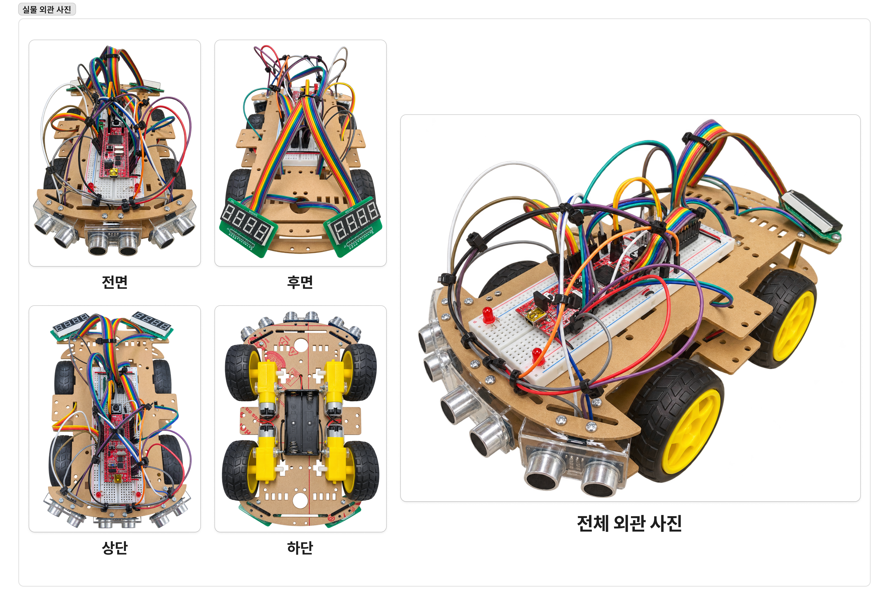

## 1. 프로젝트 개요

초음파 센서 3개로 좌·전방·우 거리를 측정해 장애물에 대응하며, Bluetooth 명령으로 수동 주행도 가능한 RC Car입니다.
ATmega128A에서 센서 측정·필터링·주행 판단·모터 제어·FND 표시를 처리합니다.
각자 차량을 구현하고 발표를 함께 진행한 프로젝트입니다.

- **자동 주행:** 거리와 거리 변화량을 이용한 후진·회전·전진 판단
- **수동 주행:** Bluetooth로 전진·후진·좌회전·우회전·정지 명령 수신
- **상태 표시:** 주행 방향과 시간·동작 통계 조회 화면 구성
- **모드 전환:** 버튼으로 수동·자동 주행 및 조회 모드 선택

## 2. 개발 정보

| 항목 | 내용 |
| --- | --- |
| 기간 | 2026.06.22 ~ 2026.06.25 |
| 참여 인원 | 1명 — 개별 차량 구현·공동 발표 |
| 언어·환경 | C, Microchip Studio, bare-metal |
| MCU | ATmega128A, 16MHz |
| 거리 센서 | HC-SR04 초음파 센서 3개 |
| 무선 입력 | ZS-040 Bluetooth 보드, UART1 |
| 구동부 | L298N 모터 드라이버, DC 모터 |
| 표시·입력 | FND 2개, 버튼, 상태 LED |
| 주요 기술 | GPIO, Timer, 외부 인터럽트, UART, PWM, 칼만 필터 |

## 3. 담당 역할

개별 RC Car의 하드웨어 구성과 센서 수집·주행 제어·표시 프로그램을 담당했습니다.

- 초음파 센서의 Echo 시간 측정과 거리 환산
- 센서별 칼만 필터 적용 및 주행 파라미터 조정
- 거리·거리 변화량에 따른 자동 주행 로직 구현
- UART 수신 명령과 수동 주행 동작 연결
- PWM·GPIO 기반 좌우 모터 제어
- FND 표시 및 버튼 기반 6개 모드 전환 구현

## 4. 시스템 구조

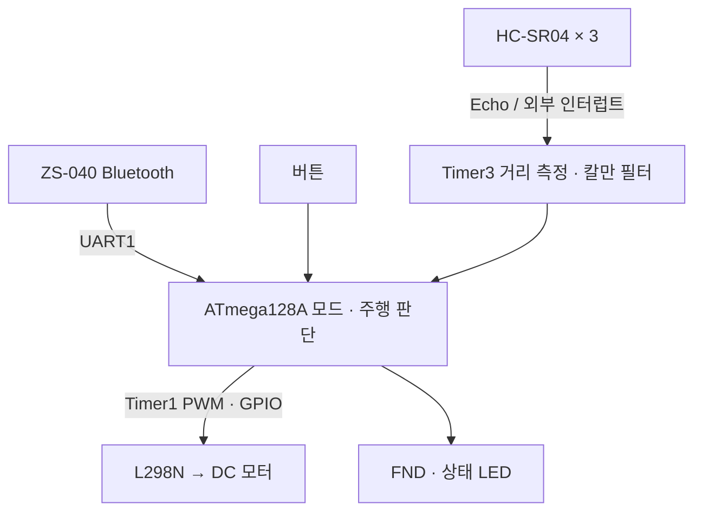

위 그림은 입력·처리·출력 흐름을 나타냅니다. MCU는 센서에 Trigger 신호를 보내고, Echo 펄스 폭을 측정합니다.
거리 측정·모드 판단·표시는 같은 MCU에서 실행됩니다.

<!-- 배선도 준비 후 아래 줄의 URL만 교체하고 주석을 해제하세요:  -->

## 5. 핵심 구현

### 초음파 거리 측정과 필터링

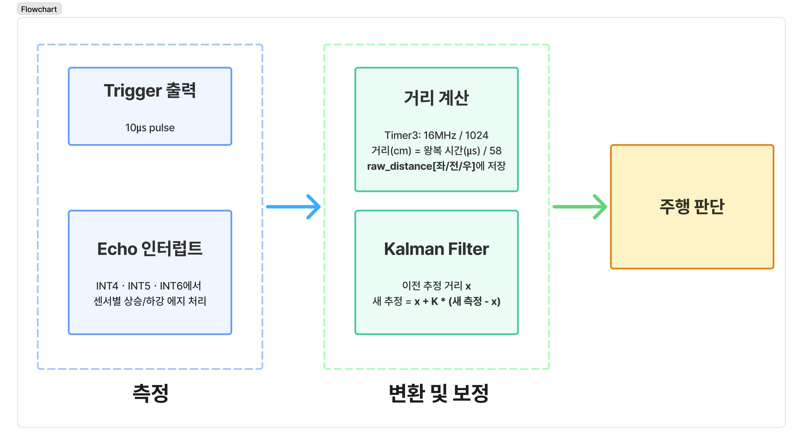

- INT4~INT6에서 Echo의 상승·하강 에지를 감지하고 Timer3 카운터 차이로 HIGH 유지 시간을 측정합니다.
- 측정 시간을 거리로 환산하고, 각 센서에 별도의 추정값·오차 공분산을 유지하는 칼만 필터를 적용합니다.
- 센서를 순환해서 Trigger하고, 메인 루프에서 필터링한 거리값을 주행 판단에 사용합니다.

**소스:** [ultrasonic.c](ultrasonic.c) · [ultrasonic.h](ultrasonic.h)

### 거리와 거리 변화량을 이용한 자동 주행

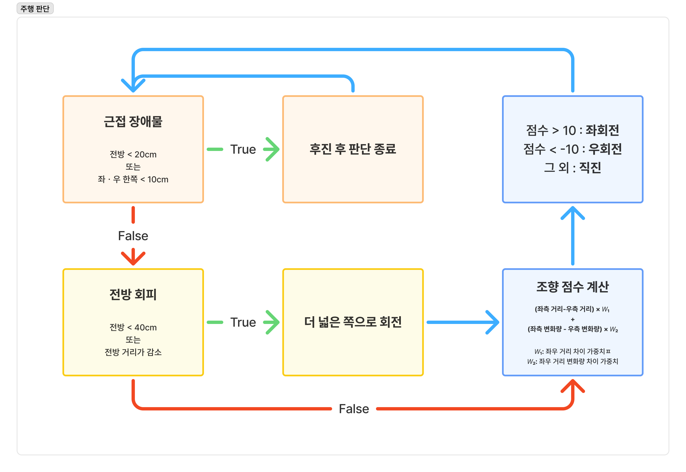

- 근접 장애물이 감지되면 후진 함수를 호출하고 해당 주행 판단 함수에서 즉시 반환합니다.
- 전방 거리와 이전 거리 대비 변화량으로 회피 방향을 판단합니다.
- 좌우 거리 차이와 거리 변화량의 가중합을 이용해 조향 방향을 결정합니다.
- 거리 변화량은 이전 값과의 차이이며, 시간으로 정규화한 속도값은 아닙니다.

**소스:** [main.c — auto_mode()](main.c)

### Bluetooth 수동 제어와 모터 출력

- UART1 수신 인터럽트에서 명령 문자를 저장하고, 메인 루프의 수동 모드에서 명령을 처리합니다.
- Timer1의 OC1A·OC1B PWM으로 좌우 모터 출력을, GPIO로 회전 방향을 제어합니다.
- UART0로 수신 문자를 전달해 PC에서 명령 수신을 확인할 수 있도록 구성했습니다.

| 명령 | 동작 |
| --- | --- |
| `F` / `f` | 전진 |
| `B` / `b` | 후진 |
| `L` / `l` | 좌회전 |
| `R` / `r` | 우회전 |
| `S` / `s` | 정지 |
| 기타 문자 | 정지 |

**소스:** [uart1.c](uart1.c) · [pwm.c](pwm.c) · [main.c — manual_mode()](main.c)

### 6개 모드 전환과 FND 표시

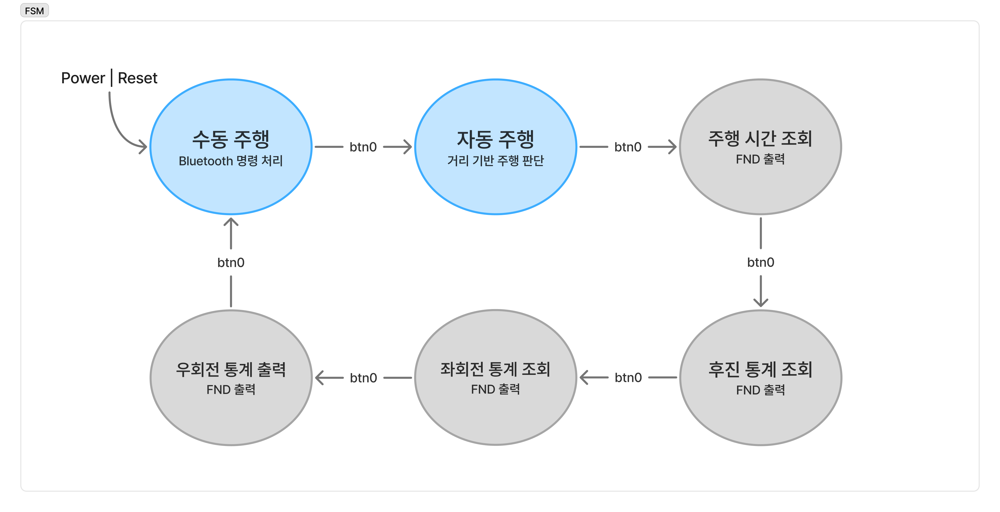

- 함수 포인터 배열과 상태 변수로 수동·자동 주행 및 조회 기능을 구분합니다.
- 버튼 입력마다 수동 → 자동 → 시간 조회 → 후진 통계 → 좌회전 통계 → 우회전 통계 순서로 전환합니다.
- 두 개의 FND에 주행 방향 애니메이션과 조회 정보를 표시하도록 구성했습니다.

**소스:** [main.c](main.c) · [button.c](button.c) · [fnd.c](fnd.c)

## 6. 문제 해결

### 초음파 측정값 변동에 대응한 필터 적용

| 구분 | 내용 |
| --- | --- |
| 문제 | 초음파 측정값의 변동을 고려해 주행 판단에 사용할 거리값을 처리할 필요가 있었습니다. |
| 접근 | 센서별 측정값을 각각 보정할 수 있도록 독립적인 필터 상태를 구성했습니다. |
| 조치 | 센서별 칼만 필터를 적용하고, 반복 주행을 통해 필터·주행 파라미터를 조정했습니다. |
| 구현 결과 | 필터링한 거리값이 자동 주행 판단에 전달되도록 연결했습니다. 오차·주행 안정성의 정량 비교 결과는 제시하지 않습니다. |

### 후진 명령이 뒤의 조건 판단으로 바뀌는 문제

| 구분 | 내용 |
| --- | --- |
| 문제 | 후진 판단 뒤에 다른 조건문이 계속 실행되면 앞서 선택한 동작이 바뀔 수 있었습니다. |
| 접근 | 주행 판단 함수에서 모터 명령이 호출되는 순서와 분기 종료 지점을 확인했습니다. |
| 현재 코드 | 근접 장애물 분기에서 후진·표시 후 `return`하도록 작성되어 있습니다. |
| 확인 범위 | 해당 함수 내부에서 후속 조건문이 후진 명령을 덮어쓰는 경로가 차단되어 있습니다. 실제 차량의 수정 전후 동작은 별도 시연 자료로 제시합니다. |

현재 소스에는 전방 회피 이후 조향 분기의 우선순위, 시간 환산·통계 집계, 공유 GPIO 포트의 비트 보존에 관한 개선 과제가 남아 있습니다.
자세한 분석은 [코드 확인 결과·개선 과제](docs/code-review.md)에 정리했습니다.

## 7. 동작 결과·관련 자료

### FND·모터 출력 동작 확인

전진·후진·좌회전·우회전·정지 제어 시 FND 표시와 모터 출력을 기록한 GIF입니다.
차량의 개별 출력 동작을 보여주는 자료이며, 바닥에서의 자동·수동 주행 시연과는 구분합니다.
각 이미지를 클릭하면 원본을 확인할 수 있습니다.

| 전진 | 후진 | 좌회전 |
| --- | --- | --- |
| [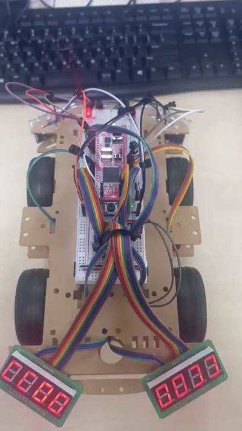](docs/images/output-forward.gif) | [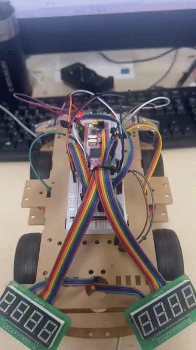](docs/images/output-backward.gif) |  |

| 우회전 | 정지 |
| --- | --- |
| [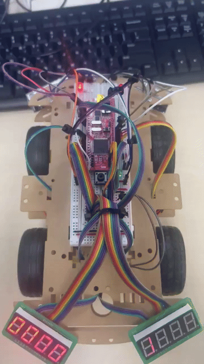](docs/images/output-right.gif) | [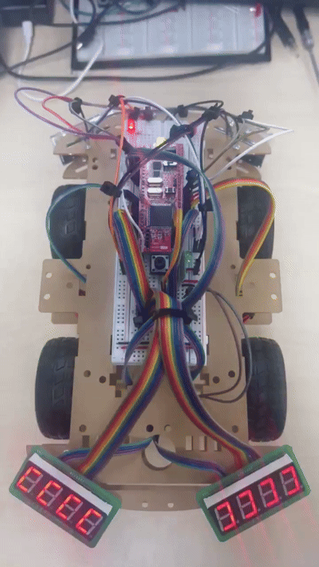](docs/images/output-stop.gif) |

### Bluetooth 명령의 UART 파형 확인

Bluetooth 모듈과 MCU 사이에서 전달되는 전진·정지·좌회전·우회전 명령의 UART 파형 자료입니다.
수동 주행 코드에서는 명령의 대문자와 소문자를 모두 처리합니다.

| 전진 `f` · `0x66` | 정지 `s` · `0x73` |
| --- | --- |
| [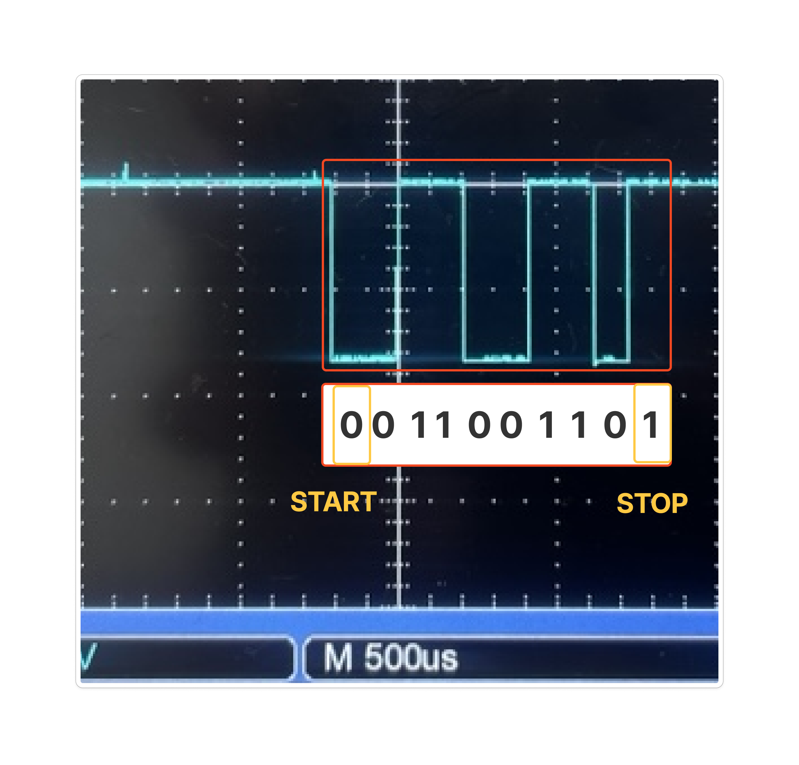](docs/images/uart-forward.png) | [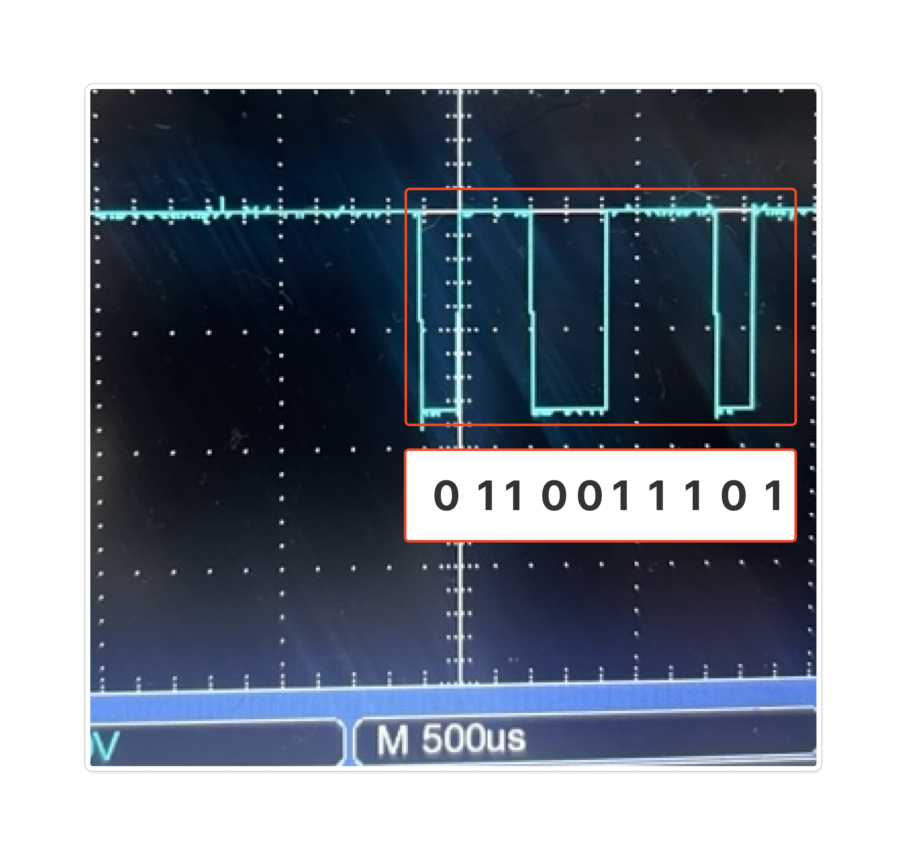](docs/images/uart-stop.png) |
| **좌회전 `l` · `0x6C`** | **우회전 `r` · `0x72`** |
| [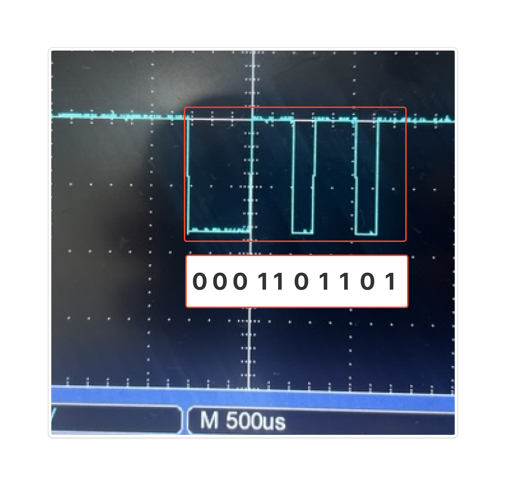](docs/images/uart-left.png) | [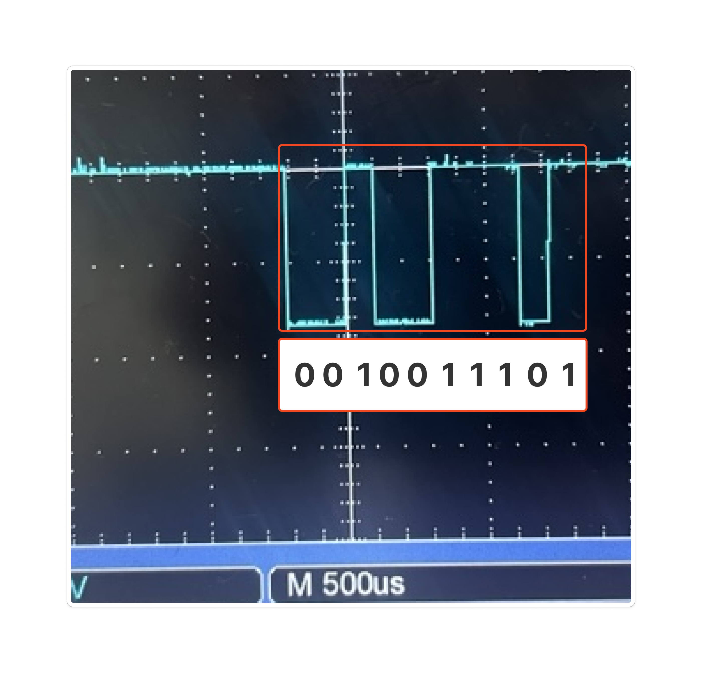](docs/images/uart-right.png) |

추가 주행 영상 삽입 위치

자동·수동 주행 영상이 준비되면 아래 링크를 교체하세요.

- [자동 주행 영상](자동_주행_영상_URL)
- [Bluetooth 수동 주행 영상](수동_주행_영상_URL)

<!-- 주행 GIF가 있으면 아래 URL을 교체하고 해당 줄의 주석을 해제하세요. -->
<!--  -->
<!--  -->

센서 측정·필터링, 자동·수동 주행, 모드 전환 및 FND 표시 코드가 포함되어 있습니다.
시간·동작 통계의 정확성과 제어 분기·GPIO 공유 문제는 개선 과제와 구분합니다.
현재 문서 정리 과정에서는 AVR 재빌드와 실제 차량 구동을 다시 검증하지 않았습니다.

| 자료 | 링크 |
| --- | --- |
| 상세 포트폴리오 | [프로젝트 소개·구현·자료](https://kevin-jwd.github.io/projects/rc-car.html) |
| 발표자료 | [발표자료 보기](발표자료_URL) |
| 코드 분석·개선 과제 | [docs/code-review.md](docs/code-review.md) |
| 소스 분리 기록 | [SOURCE.md](SOURCE.md) |

빌드 방법·주요 파일

Microchip Studio에서 `07.AUTO_CAR.cproj`를 열어 빌드합니다. 대상 MCU는 ATmega128A입니다.

| 파일 | 역할 |
| --- | --- |
| [main.c](main.c) | 초기화·메인 루프·6개 모드·수동 및 자동 주행 판단 |
| [ultrasonic.c](ultrasonic.c) | 초음파 거리 측정·센서별 칼만 필터 |
| [pwm.c](pwm.c) | Timer1 PWM·모터 방향 제어 |
| [uart1.c](uart1.c) | Bluetooth UART 명령 수신 |
| [uart0.c](uart0.c) | PC 통신·디버그 출력 |
| [fnd.c](fnd.c) | 방향·시간·통계 조회 화면 |
| [button.c](button.c) | 버튼 입력·디바운스 |
| [led.c](led.c) · [def.h](def.h) | 보조 출력·상태 상수 |

